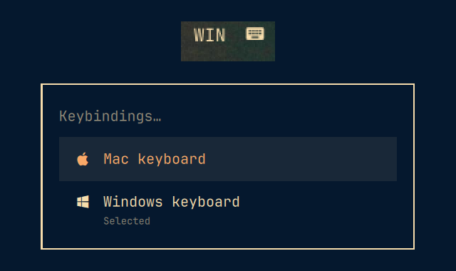

# Keyboard profile

For when you use a MacBook with an external Windows keyboard, or the other way around. Switch between the two with one key press. Each keyboard gets its own layout and its own key bindings, and only the chosen keyboard's bindings are active.



- `SUPER + ALT + L` or a click on `MAC`/`WIN` in the bar switches keyboard.
- The keyboard icon next to it lists the key bindings for either keyboard, also the one you aren't using.

You choose the keyboard yourself. The plugin doesn't detect what's plugged in. The choice applies to all keyboards and survives a reboot.

## Install

```bash
omarchy plugin add https://github.com/tripex/omarchy-keyboard-profile --enable
```

The first time you click the widget, it asks before it does anything. If you say yes, it creates `~/.config/hypr/keyboard-profile.lua` and adds one line to `hyprland.lua` so Hyprland loads that file. If you cancel, nothing is changed.

## Set up your keyboards

Edit `~/.config/hypr/keyboard-profile.lua`. Hyprland reloads it when you save.

```lua
mac = {
  kb_layout = "us",
  kb_variant = "mac",
  bindings = function()
    o.bind("SUPER + Q", "Close window", hl.dsp.window.close())
  end,
},
```

`kb_layout`, `kb_variant` and `kb_options` are optional. Leave them out to keep what `input.lua` sets. Bindings added with `o.bind` show up in the keyboard's list automatically. Bindings for both keyboards stay in `bindings.lua`.

The Windows key is SUPER and Alt is Alt, unless you swap them. The example file has a commented-out line for that.

## Command line

```bash
~/.config/omarchy/plugins/tripex.keyboard-profile/bin/keyboard-profile [status|toggle|mac|windows|bindings <mac|windows>|menu|setup|teardown]
```

## Dependencies

Omarchy 4 (Quattro) with the Lua Hyprland config. Everything else the plugin uses ships with Omarchy, and nothing is downloaded at install or run time.

Tested on Omarchy 4.0.6 with Hyprland 0.56.2.

## Removal

```bash
~/.config/omarchy/plugins/tripex.keyboard-profile/bin/keyboard-profile teardown
omarchy plugin remove tripex.keyboard-profile
rm ~/.config/hypr/keyboard-profile.lua
rm -rf ~/.local/state/tripex-keyboard-profile
```

`teardown` takes the line back out of `hyprland.lua`. The last two commands delete your profiles and the saved choice.

## License

[MIT](LICENSE)
